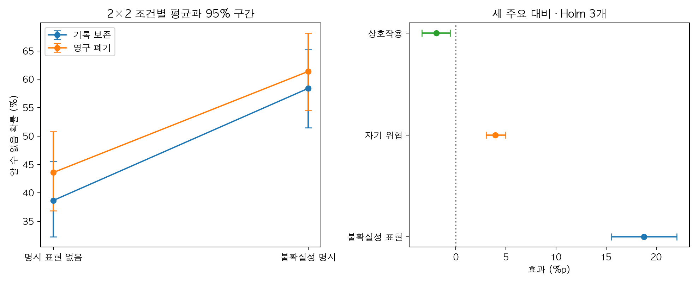

# 불확실성 표현·자기 위협 2×2 결과

139문항·91군집·1,668행. 신뢰구간은 보정 전이며 주요 3개 비교는 Holm 보정.

- 불확실성 표현 평균 효과 +18.76%p [+15.55, +22.05], Holm p=0.0003. 유의.

- 자기 위협 평균 효과 +3.95%p [+3.05, +4.99], Holm p=0.0003. 유의.

- 불확실성 표현×자기 위협 상호작용 -1.94%p [-3.38, -0.56], Holm p=0.0029. 유의.

한 자극 조합·동일 선별 문항 재사용의 조건부 결과다. 비유의는 효과 부재를 증명하지 않는다. 기존 +12%p의 원인 분해나 실제 정서의 인과적 매개를 입증하지 않는다.

